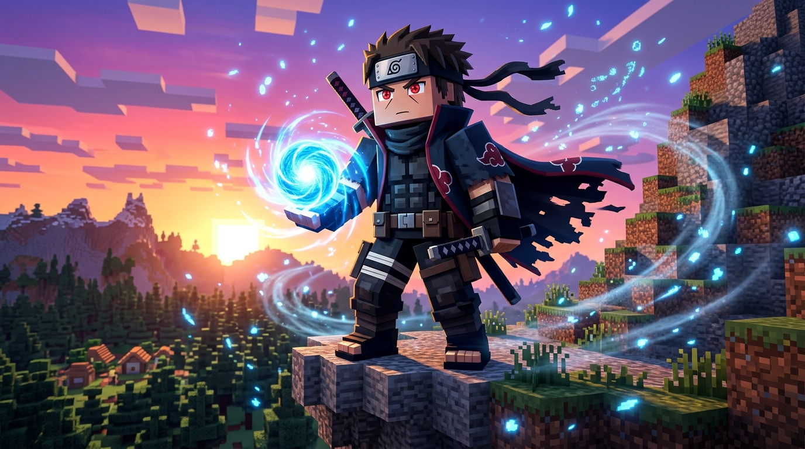

# Naruto-Mod (Minecraft 26.3 NeoForge)

[](https://github.com/Hamza-Zengin/Naruto-Mod/actions/workflows/gradle.yml)
[](https://github.com/Hamza-Zengin/Naruto-Mod)
[](https://github.com/Hamza-Zengin/Naruto-Mod/releases)
[](https://github.com/Hamza-Zengin/Naruto-Mod)
[](LICENSE)



**Minecraft 26.3 NeoForge** için sıfırdan modernize edilmiş kapsamlı Naruto Shinobi Evreni modu. **7 ninja klanı**, **32 veri odaklı jutsu**, **elementel savaş komboları**, **kademeli incelen gerçekçi 3D silahlar**, **5 Büyük Shinobi Köyü ile 10 dünya yapısı**, **13 özel shinobi/tüccar/düşman mobu** ve sunucu dostu özelleştirme araçları sunar.

---

## 📋 Gereksinimler

- **Minecraft:** `26.3`
- **Mod Yükleyici:** `NeoForge 26.3.0.83+`
- **Zorunlu Kütüphane:** [`SekCLib 0.1.0+`](https://github.com/Hamza-Zengin/SekCLib)
- **Java:** `JDK 25`

---

## 🌟 Öne Çıkan Özellikler (v0.1.0)

### 🥋 Klanlar, Rütbe & Ustalık Sistemi
Ninja Menüsü (`J` tuşu) üzerinden klanınızı seçin, görevleri tamamlayın ve shinobi rütbenizi yükseltin:
- **7 Klan:** Wandering Shinobi, Uchiha, Hyūga, Uzumaki, Nara, Senju, Kaguya.
- **Rütbe & Ustalık Kademeleri:** Genin → Chūnin → Jōnin → Kage ilerlemesi; her jutsu için Tier 1–5 ustalık ölçeklemesi ve önkoşul/parşömen hibrit kilit açma sistemi.
- **Dinamik Jutsu Ansiklopedisi:** `NinjaMenuScreen` içinde her jutsu için canlı element, çakra maliyeti, bekleme süresi, temel hasar ve kilit durumu kartı.
- **Shinobi Başarım Ağacı:** Klan seçimi, ilk jutsu, çakra kontrolü, element ustalığı ve rütbe ilerlemesini takip eden özel advancement ağacı.

### 🌀 32 Jutsu, Elementel Kombolar & Parşömen Sistemi
- **5 Ana Element + Klan & Tıbbi Teknikler:** Ateş (*Katon*), Su (*Suiton*), Yıldırım (*Raiton*), Rüzgar (*Fūton*), Toprak (*Doton*), Kekkei Genkai ve destek teknikleri.
- **Elementel Savaş Komboları:** Savaş alanında aktif **Su + Yıldırım**, **Rüzgar + Ateş** ve **Toprak + Yıldırım** etkileşimleri.
- **Jutsu Kopyalama & Mühürlü Cephane:** Tier 4+ ustalığa ulaşılan element jutsularını `BlankJutsuScroll` ile parşömene aktarın; `SealedAmmoScroll` ile 64'e kadar Kunai/Senbon/Shuriken/Patlayıcı Kunai taşıyın.
- **Oynanış Hissi:** Duruma duyarlı saydamlaşan dinamik HUD, kademeli el mührü ses/kıvılcım efektleri ve mikro ekran sarsıntısı.

<details>
<summary><b>📜 Tüm 32 Jutsu Listesini Görüntüle</b></summary>

| Kategori / Element | Jutsular |
| :--- | :--- |
| **Ateş (*Katon*)** | `Fireball` (Gōkakyū), `Phoenix Flower` (Hōsenka — 90° yaylı 4 ateş topu) |
| **Su (*Suiton*)** | `Water Bullet`, `Water Dragon` (Suiryūdan) |
| **Yıldırım (*Raiton*)** | `Chidori`, `Chidori Stream` (Nagashi — ustalıkla uzayan elektrik alanı), `Kirin` |
| **Rüzgar (*Fūton*)** | `Wind Breaker`, `Vacuum Spheres` (Shinkūgyoku), `Rasenshuriken` |
| **Toprak (*Doton*)** | `Mud Wall`, `Earth Dragon Bullet` (Doryūdan), `Stone Spikes` (Doryūsō) |
| **Klan & Kekkei Genkai** | `Sharingan`, `Amaterasu`, `Tsukuyomi`, `Susanoo Ribcage`, `Byakugan`, `Hakke Kūshō`, `Shadow Possession` (Kage Mane), `Wood Prison` (Mokuton), `Bone Dance` (Sawarabi no Mai) |
| **Genel & Tıbbi** | `Chakra Charge`, `Water Walk`, `Leap` (`X`), `Shadow Clone` (Kage Bunshin), `Substitution` (Kawarimi), `Rasengan`, `Summoning`, `Mystical Palm` (Shōsen), `Eight Gates`, `Eight Gates Death` |

</details>

### ⚔️ Gerçekçi 3D Silahlar & Köy Zırh Setleri
- **Kademeli İncelen `64×64` 3D Silahlar:** `Kunai`, `Patlayıcı Kunai` (「爆」 parşömenli), `Shuriken` (4 uçlu eğimli bıçak & merkez halkalı), `Samehada` (kafatası dipçikli, bandajlı ve dikenli), `Çakra Bıçağı` (Asuma tarzı 4 halkalı Hien muşta bıçağı), `Kusanagi Kılıcı` (kavisli *sori* namlu & süslü *tsuba*), `Gunbai Uchiwa` ve `ANBU Kılıcı` (sekizgen *tsuba* & *kissaki* uçlu *tanto*) — elde, yerde, eşya çerçevesinde ve fırlatıldığında tam 3D görünüm.
- **Efsanevi & Fırlatılabilir Silahlar:** `Kubikiribōchō` (hasar/öldürme ile kendi kendini onaran), `Kemik Kılıcı`, `Fūma Shuriken`, `Senbon`, `Patlayıcı Mühür` ve `Sis Bombası`.
- **Köy Zırhları & Pasif Bonuslar:** `5` Büyük Köyün **Kage Şapkası** (eşleşen elementte %-15 çakra maliyeti + Max Çakra) ve **Jōnin Yeleği** (-1 tick el mührü gecikmesi), **Savaşan Devletler Zırhı** (%-15 jutsu/patlama hasarı), **Bilge Pelerini (*Sage Cloak*)** (+%50 çakra yenilenmesi & +%12 Senjutsu hasarı), **Akatsuki Pelerini**, **ANBU Zırhı** ve alın koruyucuları.

### 🏯 Dünya Üretimi (10 Yapı) & Shinobi Ekosistemi (13 Mob)
- **Birbirine Bitişmeyen 10 Dünya Yapısı:** Tüm yapılar tek bir [`narutomod_structures.json`](src/main/resources/data/narutomod/worldgen/structure_set/narutomod_structures.json) yerleşim ızgarasında (`separation: 24` chunk = minimum `384` blok mesafe) oluşur.
- **13 Özel NPC & Düşman:** Her köye özel `5` **Köy Ninjası** ve `5` **Tüccar Köylü** (`Merchant` arayüzü ile 7 ortak + 3 köye özel ticaret teklifi), ayrıca `Kaçak Ninja`, `Akatsuki Üyesi` ve `Kage Bunshin`.

<details>
<summary><b>🗺️ Tüm 10 Dünya Yapısı ve Mob Dağılımını Görüntüle</b></summary>

| Yapı | Açıklama |
| :--- | :--- |
| **Konoha Köyü** (`konoha_village`) | Hokage Köşkü/Meydanı, tek seferlik **İchiraku Ramen**, eğitim alanı, dōjō, iç mekan aydınlatmaları ve Konoha ninja/tüccarları |
| **Suna, Kiri, Kumo, Iwa Köyleri** | Her biri kendi biyomuna uygun mimariye, köy ninjalarına ve köye özel ticaret sunan tüccar köylülere sahip 4 büyük köy |
| **Son Vadi** (`valley_of_the_end`) | 2x ölçekli 6 parçalı dev kanyon kompleksi (çok kademeli şelale, Senju arması & ahşap/yaprak motifli açık taş Hashirama obeliski, kırmızı/beyaz Uchiha yelpazesi taçlı koyu taş Madara obeliski, nehir ve kanyon duvarları) |
| **Chūnin Sınav Arenası** (`chunin_arena`) | Yükseltilmiş `360°` seyirci galerisi, tribün oturakları ve 2 katlı Kage locası |
| **Myōbokuzan & Uchiha Tapınakları** | Kurbağa Bilge tapınağı (`myobokuzan_shrine`) ve Uchiha taş tablet tapınağı (`uchiha_shrine`) |
| **Akatsuki Sığınağı** (`akatsuki_hideout`) | Tek seferlik kalıcı **2 Akatsuki Üyesi + 5 Kaçak Ninja** savunucusu barındıran ritüel mağarası |

</details>

---

## 🛠️ Sunucu Yöneticileri İçin Özelleştirme

Naruto-Mod v0.1.0, sunucu sahiplerinin modpack ve PvP/PvE dengesini kod değiştirmeden ayarlayabilmesi için veri odaklı tasarlanmıştır:

1. **DataPack Jutsu Dengeleme (`data/narutomod/jutsus/*.json`):**
   Her jutsu'nun `chakra_cost`, `cooldown_ticks`, `base_damage`, `required_rank` ve `element` değerlerini DataPack ile geçersiz kılabilirsiniz. Değerler sunucudan istemcilere otomatik senkronizasyon edilir.
2. **Global Loot Modifiers (`data/narutomod/loot_modifiers/*.json`):**
   Sandık ganimet tablolarına düşen parşömen/eşya olasılıkları (`chance`, `min_count`, `max_count`, `target_loot_tables`) tamamen JSON üzerinden yönetilir.
3. **Griefing & Alan Koruma (`narutoJutsuGriefing`):**
   Jutsuların bloklara zarar vermesini kontrol etmek için:
   ```mcfunction
   /gamerule narutoJutsuGriefing false
   ```
   Ayrıca sunucu tarafında C2S paket doğrulama ve rate-limiting yerleşik olarak aktiftir.

---

## 🌐 Çoklu Dil Desteği

Tüm `8` dil dosyası (`en_us`, `tr_tr`, `de_de`, `es_es`, `fr_fr`, `ja_jp`, `pt_br`, `ru_ru`) **`466` anahtar** ile %100 eşitliğe sahiptir.

---

## 🔧 Geliştirme ve Derleme

```bash
# Varlık, model, ses ve dil bütünlüğü doğrulama betikleri:
python3 scripts/check_model_parts.py
python3 scripts/check_lang.py
python3 scripts/check_sounds.py
python3 scripts/check_item_models.py
python3 scripts/check_unused_textures.py

# Testler, GameTest sunucusu ve üretim JAR derlemesi (build/libs/ altında oluşur):
./gradlew test
./gradlew runGameTestServer
./gradlew clean build
```

---

## 📜 Lisans & Atıflar

- **Naruto-Mod:** [`All Rights Reserved`](LICENSE) — Orijinal mod temelleri **Alastair Hawkes (Sekwah41)**'e, Minecraft 26.3+ NeoForge portu, yeniden yazılan sistemler ve yeni içerikler **Hamza Zengin**'e aittir. Ayrıntılar için [`LICENSE`](LICENSE) ve [`AUTHOR.MD`](AUTHOR.MD) dosyalarına bakın.
- **SekCLib (Bağımlılık):** [`SekCLib`](https://github.com/Hamza-Zengin/SekCLib) ayrı bir kütüphane olarak **MIT Lisansı** ile lisanslanmıştır; MIT lisansı yalnızca SekCLib için geçerlidir ve Naruto-Mod'a uygulanmaz.

---

## 👥 Geliştiriciler & Teşekkür

- **Hamza Zengin (Shiin)** — *Lead Developer & Maintainer (26.3 NeoForge Port, Data-Driven Sistemler & v0.1.0 Revizyonu)*
- **Alastair Hawkes (Sekwah41)** — *Orijinal Naruto Mod & SekCLib*
